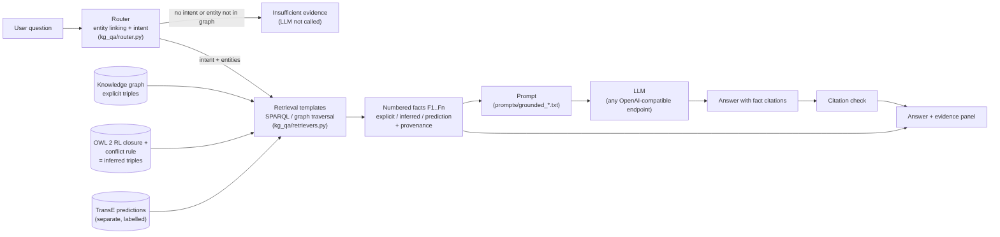

# Application architecture: knowledge-grounded question answering

The application follows the required flow: **user question → KG retrieval / reasoning → retrieved context → LLM → grounded answer + evidence**. We chose the "SPARQL-generated context with an LLM" variant of knowledge-grounded generation: the idea of retrieving evidence at query time and letting the generator use it [3] is applied to a graph [4][5], but the retrieval is exact (graph queries) rather than similarity search, because the questions depend on the exact resolved dependency tree, which text similarity cannot recover.

## Components
| Step | File | What it does |
|---|---|---|
| Load | `kg_qa/kg.py` | Parses ontology, rules and instances (the *explicit* graph); copies it, applies the OWL 2 RL closure [8] and the conflict rule `SPARQL_Queries/00_infer_conflicts.ru` (the *reasoned* graph). A fact is labelled *explicit* if its triple is in the first graph and *inferred* if it only appears in the second. |
| Route | `kg_qa/router.py` | Links names in the question to graph entities (projects, packages with optional version, licenses, license families) by exact matching against names stored in the graph, then picks a retrieval type with transparent keyword rules. No LLM is used here. |
| Retrieve | `kg_qa/retrievers.py` | 16 retrieval types (license of, direct dependencies, tree licenses, copyleft chains, exact dependency chains, dependents, deep copyleft, conflicts, compatibility, firm vs avoidable, license pair rules, frequency, non-OSI, tree size, graph statistics, license prediction). Each returns numbered facts, each with a knowledge type, how it was derived and where the underlying data came from, plus the query or procedure used. |
| Prompt | `prompts/grounded_system.txt`, `grounded_user.txt` | The LLM sees only the numbered facts and must cite them, must say "Insufficient evidence in the knowledge graph." when the facts do not answer the question, and must call predictions "predicted, not verified". |
| Generate | `kg_qa/llm.py` | One client for any OpenAI-compatible endpoint, temperature 0. The same client and settings are used for the LLM-only baseline. |
| Check | `kg_qa/qa.py` | Extracts the cited fact ids and flags an answer that cites none as ungrounded. |
| Interface | `kg_qa/cli.py`, `kg_qa/app_streamlit.py` | Command line and web page showing answer, evidence (colour-coded by knowledge type), the query used and the prompt sent. |

## Handling questions the graph cannot answer
1. **No retrieval type matches** (for example "What is the capital of France?", "Will my company get sued?"): the system answers "Insufficient evidence" and does not call the LLM.
2. **The entity is not in the graph** (for example a package that was not extracted) or **a version that is not in the graph** (for example django 6.0 when the graph has 6.1.3): the system says what is missing.
3. **Evidence is retrieved but does not answer the question:** the prompt tells the LLM to reply "Insufficient evidence", and the answer is marked as such.
4. **The answer cites no facts:** shown with a warning.
This is a design to avoid invented facts; it can still fail, which is why the comparison with a plain LLM is measured and reported rather than assumed.

## Knowledge types shown to the user
* **Explicit:** a stored triple (for example a direct dependency edge, a stored license).
* **Inferred:** derived by transitivity, subclass typing, symmetry, the property chain or the conflict rule. Rule-based conflicts also show the rule id, whether it is `cited` (backed by a source we read) or a `design decision`, and the source URLs.
* **Prediction:** a TransE guess (see `method_link_prediction.md`), always labelled "not a confirmed fact".
* **Generated text:** the LLM's wording, which may only restate the facts.

## Limitations
* The router is rule-based: a question phrased in a way the rules do not cover is answered with "insufficient evidence" even though the graph could answer it. A learned or LLM-based router would reduce this but would add a second model that can err.
* The graph is a snapshot of 179 package versions from 4 November 2026 resolved with pip; absence of a conflict in the graph is not proof that none exists in reality (closed-world reading of an open-world fact).
* 18 of 27 compatibility rules are our own design decisions; the application says so when it relies on one.
* Answers are not legal advice.
* LLM answers depend on the model and on rate limits; results can vary slightly between runs even at temperature 0.
